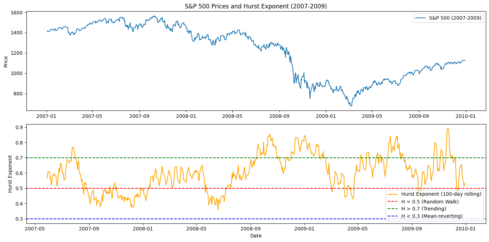
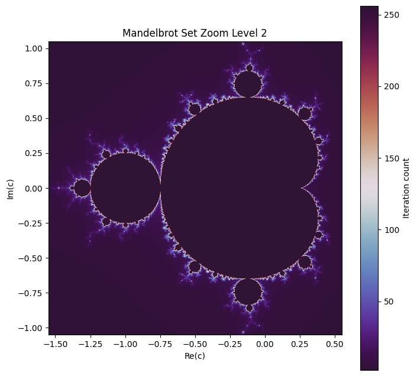

# Fractal Geometry: Computation & Market Predictability

A research project on fractals in two settings: generating fractal sets such as the Mandelbrot set, and using a fractal measure, the Hurst exponent, to study how the S&P 500 and the Dow Jones behaved before and during the 2008 financial crisis.



*S&P 500 and its 100-day rolling Hurst exponent across the 2008 crisis, from `sp500_analysis.ipynb`.*

## What I found

The Hurst exponent H measures memory in a time series: 0.5 is a random walk, above 0.5 is trending (persistent), below 0.5 is mean-reverting.

- **Before the crash, both indices sat close to a random walk.** From late 2007 to mid 2008 the rolling H stayed mostly between 0.4 and 0.65.
- **During the crash, both became strongly persistent.** From about September 2008 to early 2009 the S&P 500's rolling H rose above 0.7 and peaked near 0.85. The Dow Jones shows the same shift, peaking near 0.8.
- **The signal arrives with the move, not ahead of it.** H climbs as the sell-off is already under way, so on this evidence it describes the regime the market is in more than it predicts the next one.

These readings come from a 100-day window, which is short for a Hurst estimate, so individual values are noisy and the pattern matters more than any single number.

## What is in the repository

| Notebook | Contents |
| --- | --- |
| [`fractal_generation.ipynb`](fractal_generation.ipynb) | Computes the Mandelbrot set by escape-time iteration and renders ten successive zoom levels. |
| [`sp500_analysis.ipynb`](sp500_analysis.ipynb) | Downloads S&P 500 prices for 2007 to 2009 and plots them against the 100-day rolling Hurst exponent. |
| [`dowjones_analysis.ipynb`](dowjones_analysis.ipynb) | The same analysis for the Dow Jones Industrial Average, with a 30-day rolling mean. |



*The Mandelbrot set, from `fractal_generation.ipynb`.*

## Run it

Use Python 3.13 or older, which the libraries need. The market notebooks download their data from Yahoo Finance, so they need an internet connection.

```bash
python3 -m venv .venv
source .venv/bin/activate
pip install -r requirements.txt
jupyter notebook
```

Then open any of the three notebooks and run all cells.

## Background

The work combines mathematics (self-similarity, fractional dimensions, infinite sets), finance (trend detection, market predictability) and software (Python with NumPy, Pandas, Matplotlib, yfinance and the `hurst` package). I wrote it to see how a theoretical idea carries over to real data in finance and technology, the two fields I care most about.

## License

[MIT](LICENSE)
